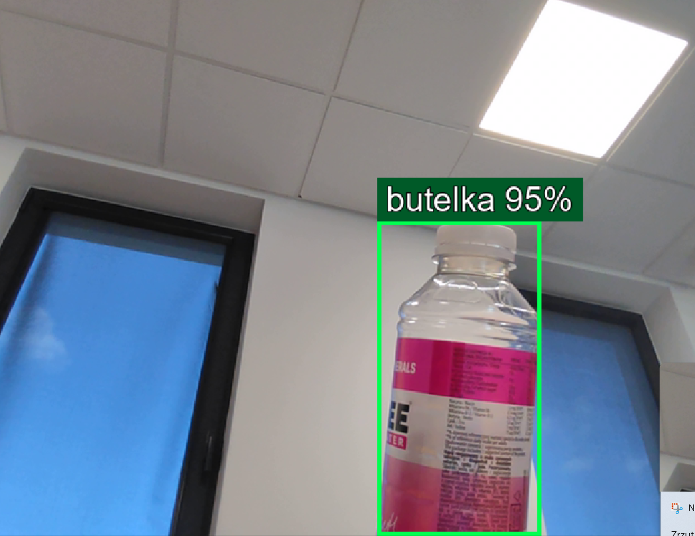
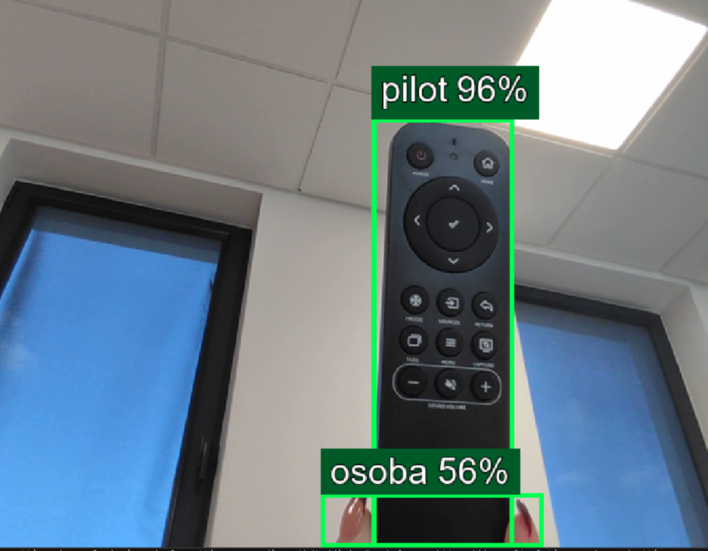

# Object Recognition AI

**Real-time object detection using Python, YOLOv8 and computer vision.**

[Polski](#opis-projektu) | [English](#project-description)

## Opis projektu

Projekt wykorzystuje sztuczną inteligencję do rozpoznawania obiektów w czasie rzeczywistym na obrazie z kamery internetowej.

Program korzysta z modelu YOLOv8n, analizuje kolejne klatki obrazu i oznacza wykryte obiekty zielonymi ramkami. Przy każdym obiekcie wyświetla polską nazwę klasy oraz poziom pewności detekcji w procentach.

Projekt powstał w celu poznania praktycznych zastosowań widzenia komputerowego (Computer Vision) oraz rozwijania umiejętności programowania w Pythonie.

## Funkcje

- Rozpoznawanie obiektów w czasie rzeczywistym.
- Obsługa kamery internetowej.
- Polskie nazwy wykrywanych obiektów.
- Wizualizacja detekcji za pomocą zielonych ramek.
- Wyświetlanie poziomu pewności detekcji.
- Możliwość zakończenia programu klawiszem `Q`.

## Technologie

- Python
- YOLOv8n
- Ultralytics
- OpenCV
- NumPy
- Pillow

## Podgląd działania

Poniżej znajdują się przykłady obiektów rozpoznawanych przez program.

### Butelka

### Pilot

## Wymagania

- Python
- Kamera internetowa
- Biblioteki wymienione w pliku `requirements.txt`
- Plik modelu `yolov8n.pt`, pobierany automatycznie przez Ultralytics przy pierwszym uruchomieniu, jeśli nie jest dostępny lokalnie

## Uruchomienie

1. Sklonuj repozytorium lub pobierz jego pliki.
2. Zainstaluj wymagane biblioteki:

   `pip install -r requirements.txt`

3. Uruchom program:

   `python wizja.py`

4. Aby zakończyć działanie programu, naciśnij `Q` w oknie z obrazem z kamery.

Kod wykorzystuje ustawienia kamery i ścieżkę czcionki dostosowane do systemu Windows.

## Project description

This project uses artificial intelligence to detect objects in real time through a webcam.

The application uses the YOLOv8n model to analyze video frames and draw green bounding boxes around detected objects. Each detection includes a Polish object label and a confidence score expressed as a percentage.

The project explores practical applications of computer vision and supports further learning and experimentation with Python and AI.

## Features

- Real-time object detection.
- Webcam input.
- Polish object labels.
- Green bounding boxes around detected objects.
- Confidence scores displayed as percentages.
- Keyboard shortcut `Q` to exit the application.

## Technologies

Python, YOLOv8n, Ultralytics, OpenCV, NumPy and Pillow.

## Project status

Educational project. The code and documentation may be extended as the project develops.
